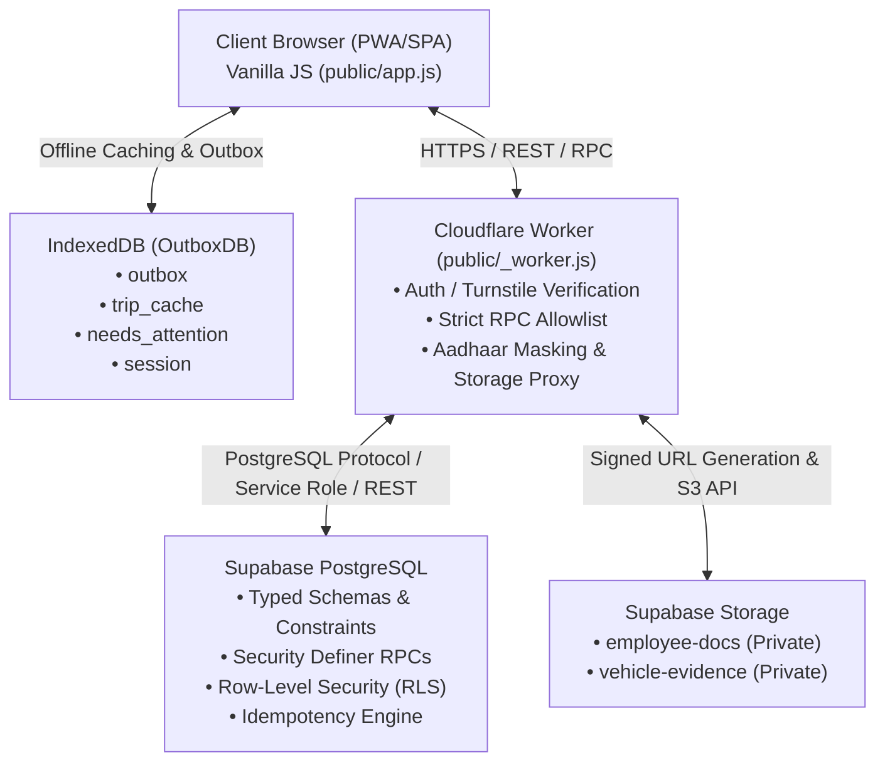
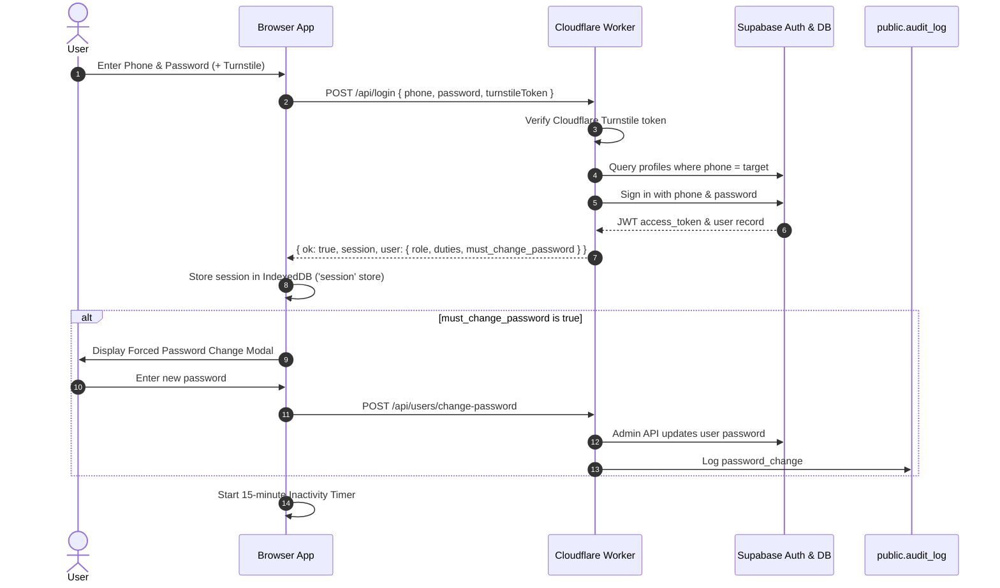
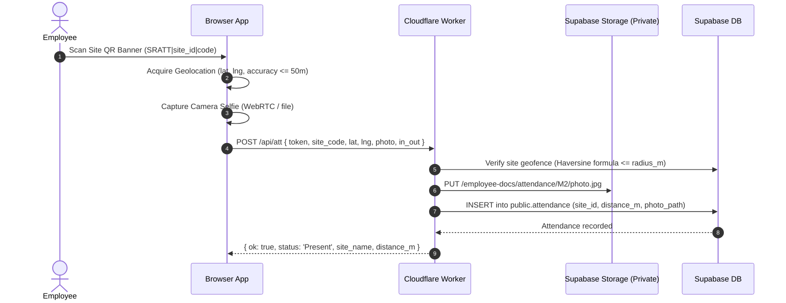
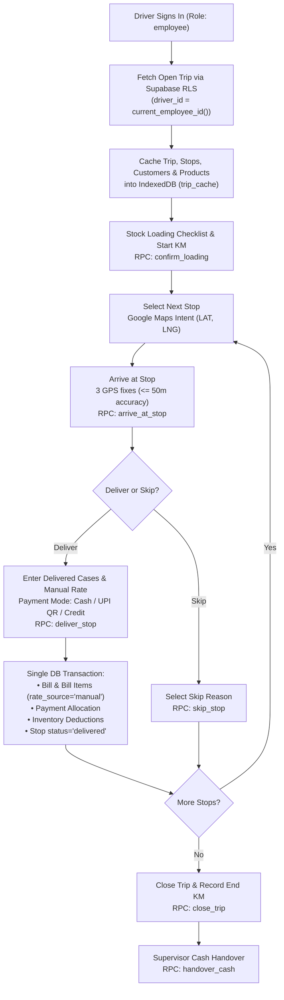
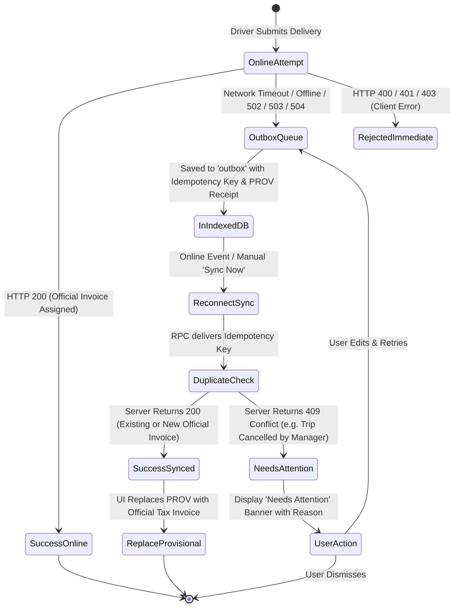

# Larven BMS: Comprehensive Flow & Architecture Specification

## 1. Executive Summary & Architecture Overview

Larven BMS is a enterprise business management system specifically architected for packaged drinking water manufacturing, distribution, route delivery, and retail operations.

### Core Architecture Tenets
1. **Zero-Trust Backend Security**:
   - All client queries and mutations are guarded by PostgreSQL Row-Level Security (RLS).
   - Operations mutating multiple tables execute within atomic `SECURITY DEFINER` RPCs with `search_path = public, pg_temp` and execute permissions restricted strictly to authenticated callers (`REVOKE EXECUTE ... FROM PUBLIC, anon`).
   - Client identity is strictly derived from `auth.uid()`, never trusted from payload parameters.
   - Idempotency keys are enforced per caller (`user_id + idempotency_key`).
2. **Offline-First Delivery Engine**:
   - Delivery drivers execute routes in low-connectivity rural and highway corridors.
   - Online-first with automatic transparent fallback to IndexedDB (`OutboxDB`).
   - Writes receive client-generated idempotency keys and immediate provisional receipt numbers (`PROV-TR101-...`).
   - Reconnect synchronization reconciles transactions in sequence and replaces provisional receipts with official tax invoice numbers (`SR/26-27/...`).
   - Outbox and trip caches survive browser restarts, reloads, and logouts.
3. **Four-Tier Role Hierarchy & Duty Tags**:
   - `admin` (System Administrator, Rank 4)
   - `owner` (Proprietor / Managing Director, Rank 3)
   - `manager` (Operations / Route Supervisor, Rank 2)
   - `employee` (Driver, Production Operator, Godown Staff, Rank 1)
   - Employees are assigned duty tags: `delivery`, `production`, `godown`.
   - Last-active owner is protected by database triggers against deactivation or deletion.
4. **Data Isolation & Module Boundaries**:
   - The Café module is strictly frozen and isolated to client `localStorage` under `larven-cafe-v1`, with zero database tables, and hidden from employee navigation.
   - Financial ledgers (`bills`, `bill_items`, `payments`, `fg_movements`, `expenses`, `advances`) are strictly append-only and have NO `DELETE` policies for any role.

---

## 2. Authentication & User Management Flow

### Endpoints & Security Checks
- **`POST /api/login`**:
  - Gated by Cloudflare Turnstile bot verification (`TURNSTILE_SECRET_KEY`).
  - Returns generic error messages (`"Invalid phone number or password"`) on failure to prevent user enumeration.
  - Returns `must_change_password: true` for newly created or reset accounts.
- **`GET /api/users`**:
  - `employee`: Access denied (403 Forbidden).
  - `manager`: Returns only `employee` accounts.
  - `owner`: Returns `manager` and `employee` accounts.
  - `admin`: Returns all accounts.
- **`POST /api/users`**:
  - Creates Supabase auth user with `phone_confirm: true` and a cryptographically generated temporary password.
  - Enforces `roleRank(caller) > roleRank(targetRole)`.
  - Sets `must_change_password: true`.
- **`PATCH /api/users/:id/duty-tags`**:
  - Allows assigning `['delivery', 'production', 'godown']` to employees.
- **`POST /api/users/:id/deactivate`**:
  - Gated by rank rules and trigger `check_last_active_owner` which rejects deactivating the sole active owner.
- **`POST /api/users/:id/reset-password`**:
  - Generates new temporary password and sets `must_change_password: true`.

---

## 3. Attendance, Geofencing & Private HR Storage Flow

### Key Security & Privacy Safeguards
1. **Aadhaar Masking**:
   - In `/api/apply`, applicant Aadhaar is scrubbed and formatted as `XXXX-XXXX-1234` before database storage.
   - Database constraint `check_masked_aadhaar` rejects any unmasked 12-digit number.
2. **Private Storage Buckets & Signed URLs**:
   - Buckets `employee-docs` and `vehicle-evidence` are private (unauthenticated HTTP reads return 403 Forbidden).
   - Photos, resumes, and generated payslip PDFs are accessed exclusively via temporary signed URLs (`/storage/v1/object/sign/employee-docs/...`) valid for 10 minutes.
   - Storage RLS policies ensure employees can only view files in their own subfolder (`attendance/<employee_id>/...`), while Managers and Owners have broader operational read access.

---

## 4. Delivery Route Execution Flow ("My Route")

### Route Lifecycle Steps
1. **Loading Checklist & Odometer**:
   - Driver verifies finished goods cases loaded against planned quantities.
   - Enters start odometer reading and submits via `confirm_loading`. Trip status transitions from `planned` / `loading` to `on_route`.
2. **Turn-by-Turn Navigation**:
   - One-click launch of native Google Maps via intent URL:
     `https://www.google.com/maps/dir/?api=1&destination=LAT,LNG`
3. **Arrival Verification**:
   - Driver clicks "Arrive at Stop 🏁".
   - Browser samples 3 consecutive geolocation fixes, filtering out any reading with accuracy $> 50$ meters.
   - Computes distance to customer's registered coordinates via Haversine formula.
   - `arrive_at_stop` records arrival time and distance meters in `trip_stops`.
4. **Customer Location Capture**:
   - If customer has no registered coordinates, employee is prompted to capture location (3 readings $\le 50$ m).
   - Once saved, employee cannot alter customer location; only Manager or Owner can re-map or update existing coordinates.
5. **Itemized Delivery & Billing**:
   - Driver enters delivered cases/bottles for each product.
   - Rates default to the customer's price list but allow manual override (`rate_source = 'manual'`).
   - Payment collected (Cash, UPI QR, or Credit).
   - Credit limit warnings are surfaced if customer balance exceeds credit limit, but do not block delivery.
   - GST (CGST 9% + SGST 9%) computed automatically.
   - Execution is encapsulated in a single atomic transaction.

---

## 5. Offline-First Outbox & Sync Specification

### Outbox Rules & Guarantees
1. **Idempotency**:
   - Every mutation generates a UUID idempotency key (`idem_deliver_stop_<random>`).
   - The server records this key in `public.idempotency_keys` with the caller's user ID.
   - Re-submitting an identical key returns the exact original response without executing duplicate billing or stock deduction.
2. **Provisional Receipts**:
   - Offline transactions receive a provisional receipt number formatted as `PROV-<tripId>-<random>` (e.g., `PROV-TR101-C6YDH`).
   - Upon reconnection, `syncAll()` replays the outbox items in strict chronological order.
   - When the server returns the official invoice number (`SR/26-27/0142`), `replaceProvisionalReceipt()` updates the UI and local cache.
3. **Queue Durability**:
   - The queue resides in IndexedDB (`OutboxDB`).
   - Outbox items and cached trips persist across browser reloads, network reconnects, and user logouts. The queue is NEVER cleared on logout.
4. **Needs Attention Quarantine**:
   - Only network-level failures (offline, timeouts, 502/503/504) remain queued for automatic retry.
   - Unrecoverable business errors (such as 409 Conflict when a trip was cancelled by a manager while the driver was offline) are moved to the `needs_attention` store.
   - The driver and manager are presented with a red alert banner displaying the exact rejection reason, with options to "Retry" or "Dismiss".

---

## 6. Day Close, Cash Handover & Production Flow

### Cash Reconciliation Formula
At route completion, the driver and supervisor execute `handover_cash`:
$$\text{Expected Net Cash} = \text{Opening Float} + \sum \text{Cash Delivery Collections} - \sum \text{Authorized En-Route Fuel/Toll Expenses}$$

- Supervisor enters actual physical cash received.
- Any variance (shortage or excess) is recorded against the trip record and logged in `public.cash_handovers`.
- An official Cash Handover Receipt is generated: `CHO-YYMM-XXXX`.
- Trip status transitions to `settled`.

### Production & Godown Stock Movement
- **`record_production`**:
  - Shift-based finished goods production logging (`shift_type`: Morning, Afternoon, Night).
  - Automatically updates stock in Plant location (`LOC-P`).
  - Tracks scrap / bottle breakage (`rejected_bottles`).
- **`transfer_stock`**:
  - Atomic transfer of finished stock between Plant and regional godowns (`Godown 1`, `Godown 2`).
  - Generates immutable entries in `public.fg_movements`.
- **`production_plan`**:
  - Compares pending orders for target delivery dates against current physical godown stock.
  - Automatically flags deficits in red and generates one-click batch creation orders.

---

## 7. Security & Role Matrix Reference

| Resource / Action | anon | employee (Driver) | manager | owner | admin |
|:---|:---:|:---:|:---:|:---:|:---:|
| **Trips (Read)** | ❌ Denied | ✅ Own Assigned Open Trip | ✅ All Trips | ✅ All Trips | ✅ All Trips |
| **Trips (Create / Plan)** | ❌ Denied | ❌ Denied | ✅ Allowed | ✅ Allowed | ✅ Allowed |
| **Trip Stops (Read)** | ❌ Denied | ✅ Stops on Own Open Trip | ✅ All Stops | ✅ All Stops | ✅ All Stops |
| **Customers (Read)** | ❌ Denied | ✅ Customers on Own Open Trip | ✅ All Customers | ✅ All Customers | ✅ All Customers |
| **Customer GPS (Update)** | ❌ Denied | ✅ Only if coordinates empty | ✅ Allowed anytime | ✅ Allowed anytime | ✅ Allowed anytime |
| **Bills & Invoices (Read)** | ❌ Denied | ✅ Own Trip Bills | ✅ All Bills | ✅ All Bills | ✅ All Bills |
| **Bills & Ledgers (Delete)**| ❌ Denied | ❌ Denied | ❌ Denied | ❌ Denied (Immutable) | ❌ Denied (Immutable) |
| **Attendance (Read)** | ❌ Denied | ✅ Own Attendance Only | ✅ All Staff | ✅ All Staff | ✅ All Staff |
| **HR Applications (Read)** | ❌ Denied | ❌ Denied | ✅ Allowed | ✅ Allowed | ✅ Allowed |
| **Staff Invites (Manage)** | ❌ Denied | ❌ Denied | ✅ Allowed | ✅ Allowed | ✅ Allowed |
| **Payslips (Read)** | ❌ Denied | ✅ Own Payslips Only | ✅ All Payslips | ✅ All Payslips | ✅ All Payslips |
| **Audit Log (Read)** | ❌ Denied | ❌ Denied | ❌ Denied | ✅ Allowed | ✅ Allowed |
| **User Management (Create)**| ❌ Denied | ❌ Denied | ✅ Employee Only | ✅ Manager & Employee | ✅ All Roles |
| **Café Module** | ❌ Denied | ❌ Hidden | ✅ Isolated (Local) | ✅ Isolated (Local) | ✅ Isolated (Local) |
