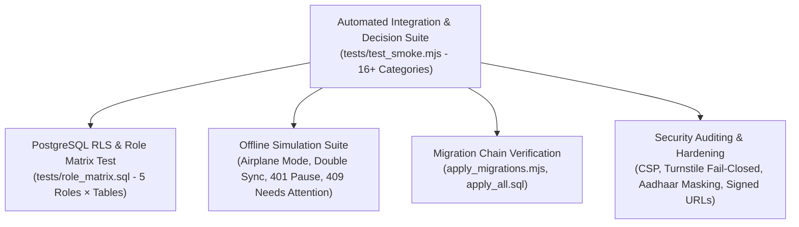

# Larven BMS: Quality Assurance & Test Plan

## 1. Quality Assurance Strategy & Pyramid

The Larven BMS test suite provides complete end-to-end verification across the database, Cloudflare Worker backend, client browser runtime, offline IndexedDB engine, and security boundaries.



---

## 2. Test Execution Quick Start

### Running the Smoke Test Suite
```powershell
npm test
```
Executes `tests/test_smoke.mjs` verifying app syntax, mock runtime, all authoritative architectural decisions, navigation routing, vendor libraries, assets, and worker hardening.

### Executing the PostgreSQL Role Matrix Test
Run within Supabase SQL Editor or via `psql`:
```bash
psql "$SUPABASE_DB_URL" -f supabase/seed.test.sql -f tests/role_matrix.sql
```
This script executes role impersonation (`SET LOCAL ROLE`, `SET LOCAL "request.jwt.claims"`) across all 5 roles (`anon`, `employee`, `manager`, `owner`, `admin`) within an atomic transaction that concludes with `ROLLBACK`, leaving zero residual test artifacts.

### Dry-Run Migration Verification
```powershell
node scripts/apply_migrations.mjs --dry-run
```
Verifies migration file syntax, chronological timestamp order, single-transaction boundaries, and presence in `supabase/apply_all.sql`.

---

## 3. Test Categories & Scenarios

### Category A: Authoritative Decisions & Role Permissions

| Test ID | Scenario | Expected Outcome | Verification Method |
|:---|:---|:---|:---|
| **AUTH-01** | Role hierarchy evaluation | `roleRank('admin') > roleRank('owner') > roleRank('manager') > roleRank('employee')` | `test_smoke.mjs` Section 3 |
| **AUTH-02** | Owner user creation | Owner can create Manager and Employee; cannot create Admin or Owner | `test_smoke.mjs` Section 3 |
| **AUTH-03** | Manager user creation | Manager can create Employee; cannot create Manager, Owner, or Admin | `test_smoke.mjs` Section 3 |
| **AUTH-04** | Last active owner guard | Trigger `check_last_active_owner` aborts deactivating the sole active owner | `test_smoke.mjs` Section 3 |
| **AUTH-05** | Duty tags assignment | Employee accounts can have `delivery`, `production`, `godown` assigned | `test_smoke.mjs` Section 3 |
| **AUTH-06** | Service-role profile mutation | Direct client `UPDATE public.profiles` rejected by trigger `check_profile_service_role_only` | `tests/role_matrix.sql` Section 2 |

### Category B: Offline Outbox, Provisional Receipts & Synchronization

| Test ID | Scenario | Expected Outcome | Verification Method |
|:---|:---|:---|:---|
| **OFFLINE-01**| Airplane-mode delivery | Network down; delivery writes to IndexedDB `outbox` with status `pending`; returns provisional receipt `PROV-TR101-...`; UI renders provisional badge | `test_smoke.mjs` Scenario 1 |
| **OFFLINE-02**| Reconnect sync | Network restored; `syncAll()` replays items in sequence; server returns official invoice `SR/26-27/...`; UI updates in place | `test_smoke.mjs` Scenario 2 |
| **OFFLINE-03**| Double sync (Idempotency) | Re-sending an already synced delivery with same idempotency key returns HTTP 200 with existing invoice without creating duplicate bills or stock deductions | `test_smoke.mjs` Scenario 2 & `role_matrix.sql` |
| **OFFLINE-04**| Expired session while offline | 401 Unauthorized pauses sync without dropping queue; user logs in again; queue resumes and completes sync | `test_smoke.mjs` Scenario 3 |
| **OFFLINE-05**| Trip cancelled while offline | Driver delivers offline, but manager cancelled trip on server; sync returns 409 Conflict; item moved to `needs_attention` store with reason; UI displays Retry/Dismiss card | `test_smoke.mjs` Scenario 4 |
| **OFFLINE-06**| Logout persistence | User logging out does NOT clear the outbox or trip cache in IndexedDB | `test_smoke.mjs` Scenario 3 |

### Category C: Field Delivery & Operational Modules

| Test ID | Scenario | Expected Outcome | Verification Method |
|:---|:---|:---|:---|
| **ROUTE-01** | Employee Route Loading | Employee loads open trip via Supabase RLS reads (`driver_id = current_employee_id()`); no fallback to 'M1' or 'any unsettled trip' | `test_smoke.mjs` Section 16 |
| **ROUTE-02** | Turn-by-turn Navigation | Stop item renders valid Google Maps intent link `https://www.google.com/maps/dir/?api=1&destination=LAT,LNG` | `test_smoke.mjs` Section 11 |
| **ROUTE-03** | GPS Location Accuracy | Geolocation fixes $> 50$ meters rejected; fixes $\le 50$ meters accepted | `test_smoke.mjs` Section 11 |
| **ROUTE-04** | Customer Location Guard | Employee can only capture location if currently empty; Manager can update at any time | `test_smoke.mjs` Section 11 & `role_matrix.sql` |
| **ROUTE-05** | Pricing & Variance Auditing | Item delivered with manual rate; stored with `rate_source = 'manual'`; variance report flags deviations from price list | `test_smoke.mjs` Section 3 |
| **ROUTE-06** | Credit Limit Warning | Customer exceeding credit limit receives warning badge in response, but delivery is not hard-blocked | `test_smoke.mjs` Section 3 |
| **ROUTE-07** | Day Close Reconciliation | Cash handover calculates: Opening Float + Collections - Expenses = Net Cash; issues receipt `CHO-YYMM-XXXX` | `test_smoke.mjs` Section 11 |

### Category D: HR, Attendance, Storage & Privacy

| Test ID | Scenario | Expected Outcome | Verification Method |
|:---|:---|:---|:---|
| **HR-01** | Aadhaar Masking | Inputting 12-digit Aadhaar in `/api/apply` formats it as `XXXX-XXXX-1234`; check constraint `check_masked_aadhaar` rejects plaintext | `public/_worker.js` & `20261127000008_attendance_and_hr.sql` |
| **HR-02** | Private Storage Access | Direct unauthenticated GET to `employee-docs` returns 403; access only via `/storage/v1/object/sign/...` signed URLs | `public/_worker.js` & `20261127000008_attendance_and_hr.sql` |
| **HR-03** | Attendance Geofence | GPS distance > radius returns 400 Geofence error; distance $\le$ radius uploads selfie to storage and inserts attendance | `public/_worker.js` |
| **HR-04** | Payslip PDF Generation | Manager generates payslip; PDF uploaded to `employee-docs/payslips/`; employee views signed link in `/api/slips` | `public/_worker.js` |
| **HR-05** | Legacy Cleanup | Zero references to `env.KV`, `ADMIN_KEY`, `akey()`, `seed()`, or bill PIN card in worker or client code | `test_smoke.mjs` Section 14 |

### Category E: Database Immutability & Security Definer RPCs

| Test ID | Scenario | Expected Outcome | Verification Method |
|:---|:---|:---|:---|
| **DB-01** | Financial Immutability | NO `DELETE` policies on `bills`, `bill_items`, `payments`, `fg_movements`, `expenses`, `advances` for any role (including Owner & Admin) | `tests/role_matrix.sql` & `test_smoke.mjs` Section 8 |
| **DB-02** | Customer RLS Scoping | Employee can only SELECT customers assigned to their active open trip (`is_customer_on_my_open_trip`) | `tests/role_matrix.sql` Section 2 |
| **DB-03** | Unauthenticated Access | `anon` role cannot SELECT, INSERT, UPDATE, or DELETE on any operational table | `tests/role_matrix.sql` Section 1 |
| **DB-04** | RPC Execute Restrictions | `EXECUTE` on all write RPCs revoked from `PUBLIC` and `anon`; authenticated execution only | `supabase/migrations/20261127000004_rpcs.sql` & `role_matrix.sql` |
| **DB-05** | Scoped Idempotency Keys | Idempotency keys scoped to `user_id + idempotency_key`; cannot collide across different users | `supabase/migrations/20261127000007_rpc_hardening.sql` |

---

## 4. Regression & Continuous Verification

All tests are integrated into standard CI/CD checks:
1. `npm test` runs on every pull request and commit.
2. Migrations are dry-run validated in sequential timestamp order.
3. Smoke test asserts zero syntax errors, CSP cleanliness (no `unsafe-inline`), no base64 in `index.html`, and strict vendor checksums.
